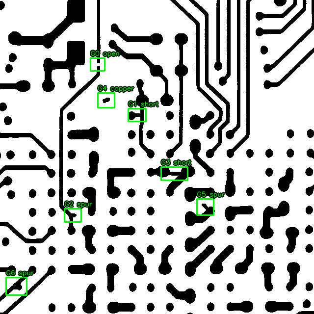
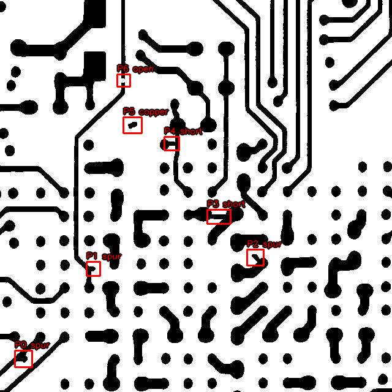
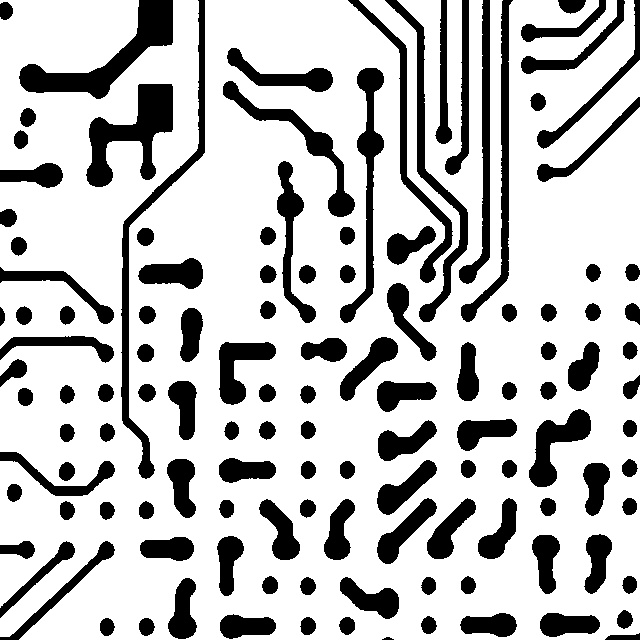

# PCB Defect Detection

A classical image processing pipeline for printed circuit board (PCB) defect detection and classification using C++ and OpenCV.

| Ground Truth | Prediction |
|---|---|
|  |  |

## Background

Automated optical inspection (AOI) is widely used in PCB manufacturing to identify defects that may affect circuit functionality and product reliability.

This project explores a reference-based inspection approach that compares a defect-free template image with a test image to identify structural differences. Rather than relying on deep learning, the pipeline uses classical image processing and connectivity-based rules to locate and classify PCB defects.

## Methods

### Image Differencing

Computes the pixel-wise absolute difference between the template image $I_r$ and the test image $I_t$:

$$D(x,y)=|I_t(x,y)-I_r(x,y)|$$

The difference image is binarized to extract potential defect regions.

### Morphological Operations

Morphological opening is applied to suppress isolated noise and small unwanted responses while preserving candidate defect regions:

$$A \circ B = (A \ominus B) \oplus B$$

where $A$ is the binary difference mask and $B$ is the structuring element.

### Contour-Based Defect Localization

External contours are extracted from the processed difference mask. Each candidate region is enclosed by an axis-aligned bounding box for defect localization.

### Connected Component Analysis

Connected component analysis is used to examine the local connectivity of copper regions surrounding each candidate defect.

Changes in connectivity between the template and test images provide structural information for distinguishing different defect types.

### Rule-Based Defect Classification

Defect regions are analyzed based on two types of structural differences:

**Extra copper** — copper present in the test image but absent from the template.

**Missing copper** — copper present in the template but absent from the test image.

These differences, combined with local connectivity information, are used to classify candidate defects into six categories:

| Defect Type | Description |
|---|---|
| Open | Interruption of a conductive trace |
| Short | Unintended connection between conductive regions |
| Mousebite | Missing copper along a trace boundary |
| Spur | Unwanted copper protruding from a trace |
| Spurious Copper | Isolated unwanted copper region |
| Pin-hole | Small hole within a copper region |

## Dataset

This project uses the [DeepPCB](https://github.com/tangsanli5201/DeepPCB) dataset for algorithm development and performance evaluation.

The dataset contains 1,500 aligned PCB image pairs at a resolution of 640 × 640 pixels, with bounding box annotations for six defect categories.

| Subset | Image Pairs |
|---|---:|
| Trainval | 1,000 |
| Test | 500 |
| Total | 1,500 |

| Template Image | Test Image |
|---|---|
|  |  |

## Results

### Evaluation Protocol

Detection performance is evaluated using an Intersection over Union (IoU) threshold.

$$IoU = \frac{|B_p \cap B_g|}{|B_p \cup B_g|}$$

where $B_p$ and $B_g$ denote the predicted and ground truth bounding boxes, respectively.

Two evaluation criteria are considered:

- **Location Only** — a prediction is considered correct when its IoU with a ground truth box exceeds the IoU threshold, regardless of the predicted class.
- **Location + Class** — a prediction must satisfy both the IoU threshold and the correct defect class.

### Quantitative Evaluation

Baseline performance on the DeepPCB trainval subset:

| Evaluation Setting | Value |
|---|---:|
| Image Pairs | 1,000 |
| Ground Truth Defects | 6,873 |
| Predicted Defects | 17,390 |
| IoU Threshold | > 0.33 |

| Metric | Location Only | Location + Class |
|---|---:|---:|
| True Positives | 6,649 | 6,476 |
| False Positives | 10,741 | 10,914 |
| False Negatives | 224 | 397 |
| Precision | 38.23% | 37.24% |
| Recall | 96.74% | 94.22% |
| F1-score | 54.81% | 53.38% |

### Classification Performance

Classification accuracy is evaluated separately on location-matched defects.

| Metric | Value |
|---|---:|
| Location-Matched Defects | 6,649 |
| Correctly Classified Defects | 6,464 |
| Classification Accuracy | 97.22% |

The baseline achieves high localization recall and classification accuracy on matched defects. However, the large number of false positives remains the primary limitation of the current pipeline.

## Failure Case Analysis

Failure cases are systematically documented to investigate root causes, evaluate potential solutions, and track algorithm improvements.

| Case | Description |
|---|---|
| [Mousebite-to-Open Misclassification](/failure_cases/mousebite_to_open/README.md) | Mousebite defects are misclassified as open defects. |

## Tech Stack

- C++17
- OpenCV
- CMake

## References

1. S. Tang et al., [Online PCB Defect Detector on a New PCB Defect Dataset](https://arxiv.org/abs/1902.06197), 2019.
2. [DeepPCB Dataset](https://github.com/tangsanli5201/DeepPCB).
3. [OpenCV Documentation](https://docs.opencv.org/4.x/).

4. [CMake Documentation](https://cmake.org/cmake/help/latest).