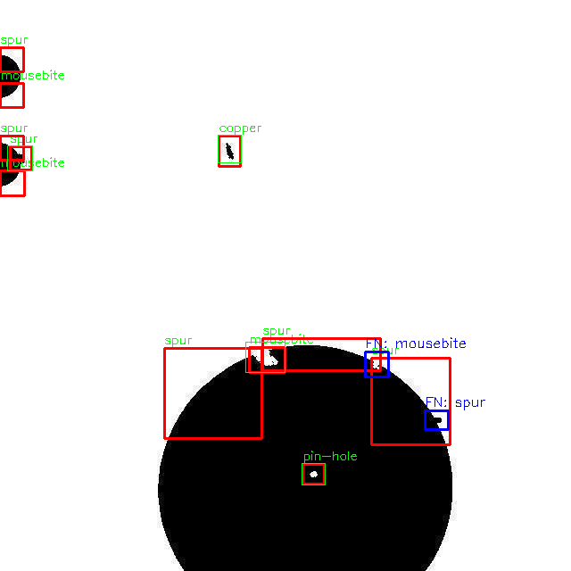
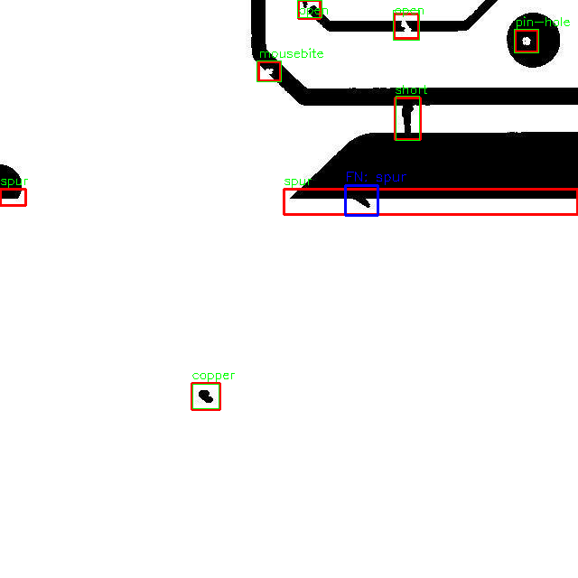

# Edge-Induced Localization

## Problem Description

Unwanted edge responses merge with actual defects, resulting in oversized bounding boxes and low IoU scores.

| ID: 20085000 | ID: 20085012 |
|---|---|
|  |  |

## Root Cause Analysis

Local copper boundary variations produce unwanted edge responses. These variations may be associated with the synthetic defect generation process.

## Proposed Solution

TBD.

## Validation Results

TBD.

## Experimental Results

### Experiment 01 — Boundary Tolerance

- **Method**: Suppress boundary differences using morphological dilation.
- **Result**: Some genuine defects were removed along with unwanted edge responses.
- **Conclusion**: This method is too aggressive.

