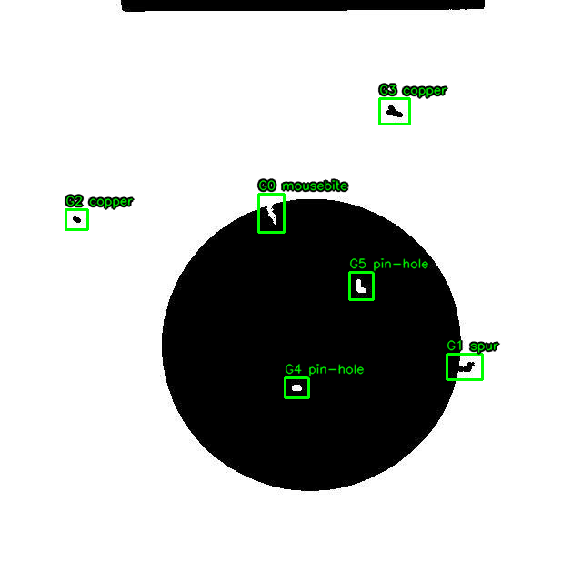
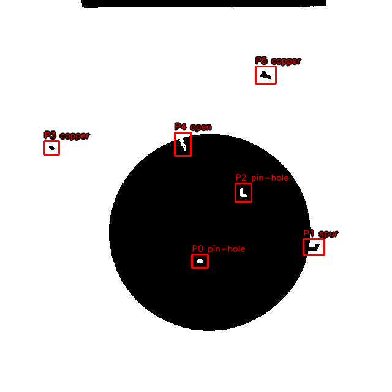
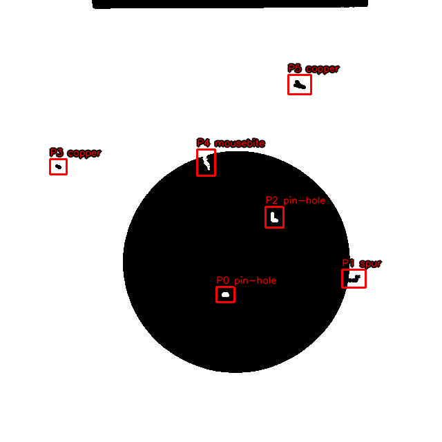

# Mousebite-to-Open Misclassification

## Problem Description

A mousebite defect is incorrectly classified as an open defect.

- Image ID: 20085007
- Ground truth: mousebite
- Prediction: open

| Ground Truth | Prediction |
|---|---|
|  |  |

## Root Cause Analysis

The original classification logic identifies an open defect when a previously connected copper region is split into two or more connected components.

However, this logic does not consider the area of each connected component.The connected component analysis reveals the following results:

| Component ID | Area (pixels) |
|---|---:|
| 1 | 1997 |
| 2 | 1 |

The second component contains only one pixel but is still counted as a valid connected component. As a result, the algorithm incorrectly interprets the small isolated component as a disconnected copper region, leading to a false open classification.

## Proposed Solution

Introduce a minmum connected component area threshold to exclude small isolated components from the connectivity analysis.

Before

```Cpp
if (remainingIds.size() >= 2) {
    return "open";
}
```
After

```Cpp
const int minComponentArea = 5;
set<int> validIds;

for (int id : remainingIds) {
    int area = stats.at<int>(id, CC_STAT_AREA);

    if (area >= minComponentArea) {
        validIds.insert(id);
    }
}

if (validIds.size() >= 2) {
    return "open";
}
```

## Validation Results

### Single-Image Evaluation

| Before | After |
|---|---|
|  |  |

| Metric | Before | After |
|---|---:|---:|
| Location F1 | 1.0000 | 1.0000 |
| Location + Class F1 | 0.8333 | 1.0000 |
| Classification Accuracy | 83.33% | 100% |
| Correct Classifications | 5/6 | 6/6 |

Raw results: [Before](before/summary.txt) | [After](after/summary.txt)

### Regression Testing

DeepPCB `trainval` | 1,000 image pairs | IoU > 0.33

**80.23% reduction in mousebite-to-open misclassifications.**

| Metric | Before | After | Change |
|:---|---:|---:|---:|
| Mousebite → Open | 521 | 103 | -418 |
| Open → Mousebite | 17 | 27 | +10 |
| Localization F1 | 54.81% | 54.81% | — |
| Detection F1 (with class) | 50.02% | 53.38% | +3.36% |
| Classification Accuracy | 91.08% | 97.22% | +6.14% |

Raw results: [Before](results/summary_before.txt) | [After](results/summary_after.txt)